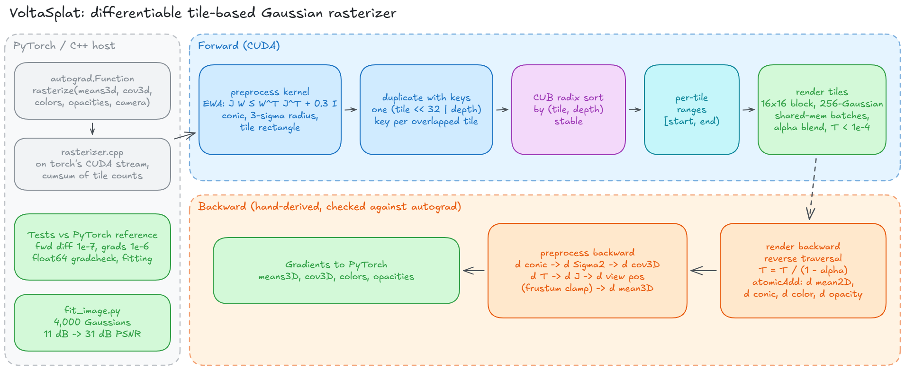
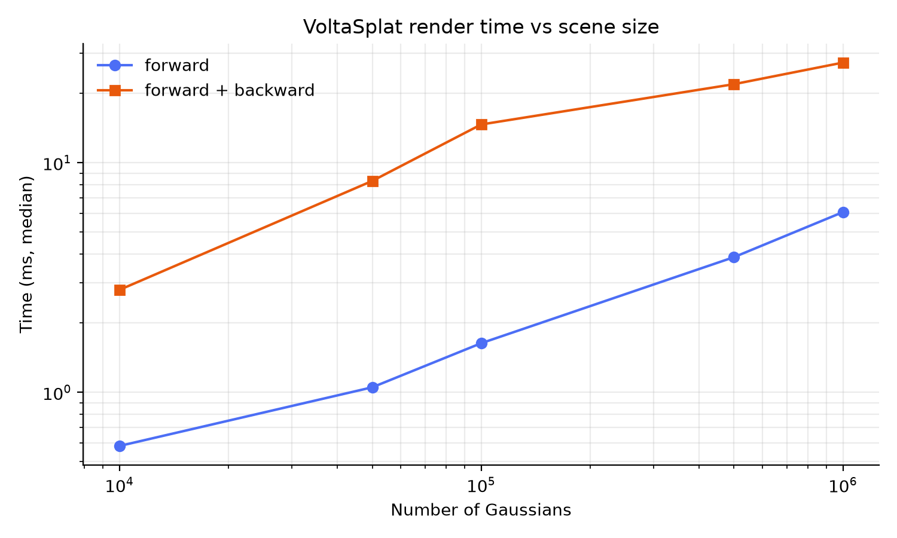
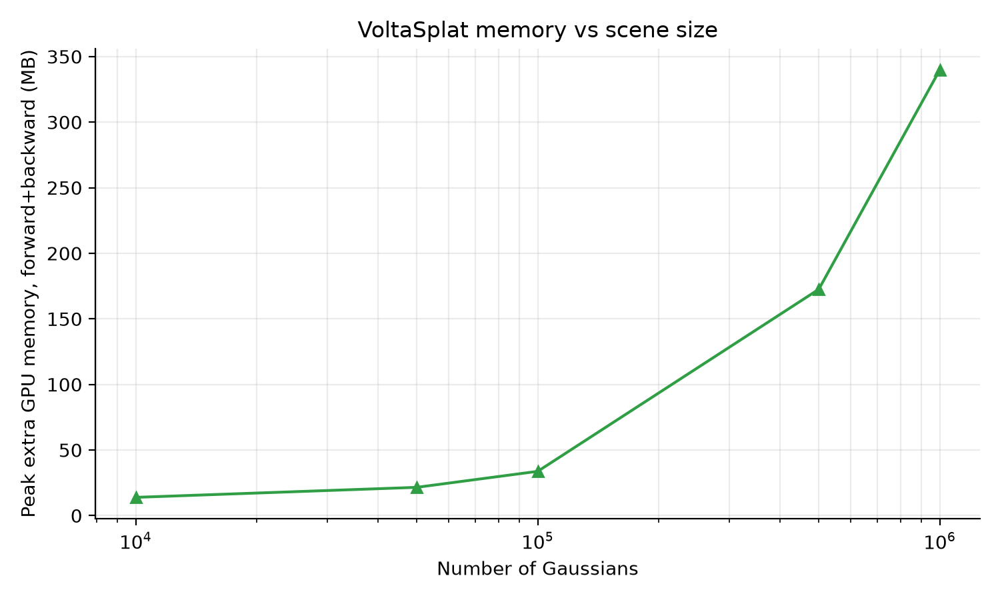

# VoltaSplat: Differentiable CUDA Rasterizer for 3D Gaussian Splatting

   

VoltaSplat is a from-scratch, tile-based, differentiable rasterizer for 3D Gaussian Splatting written in CUDA/C++ and exposed to PyTorch as an `autograd.Function`. Given N 3D Gaussians (mean, covariance, color, opacity) and a pinhole camera it renders an image, and given a gradient on the image it returns gradients for **all four per-Gaussian parameter tensors**, including the 3D means and 3D covariances, through the projection.

* **Forward:** EWA projection of 3D covariances with the first-order (Jacobian) approximation, 3-sigma screen bounds, **one sort key per overlapped 16x16 tile** (`tile << 32 | depth`), a CUB radix sort, per-tile ranges, and a front-to-back alpha-compositing kernel that stages 256 Gaussians at a time in shared memory with early termination.
* **Backward:** reverse-order compositing gradients with `atomicAdd`, then an analytic chain through the projection (conic inverse, `T = J W`, the frustum clamp, the viewport transform) to `means3d` and `cov3d`.
* **Verified against an independent implementation:** a pure-PyTorch reference renderer reproduces the CUDA image to ~1e-7 and the CUDA gradients to ~1e-6 relative error; the reference's own gradients are checked against float64 finite differences.



## Contents
1. [Results](#1-results) 2. [Method](#2-method) 3. [Correctness evidence](#3-correctness-evidence) 4. [API](#4-api) 5. [Repository structure](#5-repository-structure) 6. [Build, test, benchmark](#6-build-test-benchmark) 7. [Limitations and future work](#7-limitations-and-future-work) 8. [License and citation](#8-license-and-citation)

## 1. Results

### Render and gradient cost (measured)
<!-- BENCHMARK_START -->
Measured on NVIDIA GeForce RTX 5060 Laptop GPU (torch 2.11.0+cu128, CUDA 12.8), 800x800 output, median of CUDA-event timings; scenes of random Gaussians with 1.5-5 px screen-space sigma.

| Gaussians | forward (ms) | forward FPS | forward+backward (ms) | peak extra GPU memory (MB) | Gaussian-tile pairs |
|---:|---:|---:|---:|---:|---:|
| 10,000 | 0.58 | 1716 | 2.79 | 14 | 68,825 |
| 50,000 | 1.05 | 953 | 8.32 | 22 | 343,731 |
| 100,000 | 1.63 | 612 | 14.65 | 34 | 688,575 |
| 500,000 | 3.87 | 258 | 21.95 | 173 | 3,441,517 |
| 1,000,000 | 6.08 | 164 | 27.25 | 340 | 6,874,036 |
<!-- BENCHMARK_END -->




All numbers come from `benchmarks/run_benchmarks.py` (CUDA events, median of 20 runs after warm-up, `torch.cuda.max_memory_allocated`); nothing is hard-coded. They are for random scenes whose Gaussians project to 1.5-5 px sigma, i.e. the regime of a trained 3DGS model. They have **not** been compared with `gsplat` or the original `diff-gaussian-rasterization`, so no relative claim is made.

### Fitting a target image (end to end)
`examples/fit_image.py` optimises 4,000 Gaussians (free 3D position, anisotropic scale, rotation, color, opacity) to a procedurally generated 256x256 image with Adam on the standard 3DGS loss `0.8 L1 + 0.2 (1 - SSIM)`:

| Step | PSNR | SSIM |
|---:|---:|---:|
| 0 | 11.0 dB | 0.249 |
| 800 | **31.2 dB** | **0.979** |

(46 ms per optimisation step on an RTX 5060 Laptop GPU, including SSIM and Adam.) The run exists to show that gradients to positions, scales, rotations, colors and opacities are all useful, which is what the means/covariance backward pass provides.

## 2. Method

**Projection.** For a Gaussian with view-space mean `t = R m + b` and covariance `S`, the 2D covariance is `Sigma' = J R S R^T J^T` (top-left 2x2) with `J = [[fx/tz, 0, -fx tx/tz^2], [0, fy/tz, -fy ty/tz^2]]`. `tx/tz` and `ty/tz` are clamped to 1.3x the field of view before linearising, and 0.3 is added to the diagonal (a one-pixel low-pass filter). The conic is `Sigma'^{-1}`; the radius is `ceil(3 sqrt(lambda_max))`.

**Tile binning.** The bounding square of every visible Gaussian is converted into a rectangle of 16x16 tiles; an inclusive scan of per-Gaussian tile counts sizes one global key/value list, `duplicate_with_keys` writes one `(tile << 32 | depth bits)` key per overlapped tile (positive floats sort like integers), CUB sorts only the bits that matter, and `identify_tile_ranges` records `[start, end)` per tile.

**Compositing.** One 16x16 thread block per tile loads batches of 256 Gaussians into shared memory and every pixel evaluates `alpha = min(0.99, o exp(-0.5 d^T Q d))`, skipping `alpha < 1/255`, accumulating `C += alpha T c`, `T *= 1 - alpha`, and stopping *before* the Gaussian that would push `T` below 1e-4. A block stops once all of its pixels are saturated.

**Backward.** Per pixel, walking from the last contributor back to the first, the transmittance is recovered as `T = T / (1 - alpha)`, giving `dC/dalpha_i = c_i T_i - (sum of colour behind i) / (1 - alpha_i)`; gradients w.r.t. opacity, conic and 2D mean follow, with no gradient through a clamped `alpha`. A second kernel maps `dL/dconic` and `dL/dmean2D` to `dL/dcov3D` and `dL/dmean3D`: `dSigma' = -Q (dL/dQ) Q`, `dS = sum_ij dSigma'_ij T_i^T T_j`, `dT_i = 2 sum_j dSigma'_ij S T_j^T`, `dJ = dT W^T`, and then through `J`'s dependence on the view-space position, including the case where the frustum clamp is active. See `docs/MATH_SPEC.md` for the long form.

## 3. Correctness evidence

| Check | Where | Result |
|---|---|---|
| CUDA image vs PyTorch reference renderer (24 / 60 / 150 Gaussians, ragged 80x64 image, camera with rotation + translation, Gaussians spanning many tiles, Gaussians behind the camera) | `tests/test_rasterizer.py` | max abs difference < 1e-5 (observed ~2e-7) |
| CUDA gradients vs autograd of the reference, for `means3d`, `cov3d`, `colors`, `opacities` | same | relative error < 1e-4 (observed ~1e-6) |
| Reference gradients vs float64 finite differences (`torch.autograd.gradcheck`) | `tests/test_reference_gradcheck.py` (CPU-only) | passes |
| A single large Gaussian is drawn in every tile it overlaps | `test_large_gaussian_spans_tiles` | >= 9 tiles lit |
| Culled Gaussians get exactly zero gradient; empty and fully-culled scenes render black | `test_culled_...`, `test_empty_...` | passes |
| Optimisation reduces loss through all four parameter tensors | `test_fitting_reduces_loss`, `examples/fit_image.py` | loss falls > 40%; 11 -> 31 dB |

The reference (`voltasplat/reference.py`) is deliberately independent: dense per-pixel tensor operations in depth order, no tiles, no CUDA.

## 4. API

```python
import torch, math
from voltasplat.cameras import Camera
from voltasplat.modules import rasterize
from voltasplat.gaussians import build_cov3d          # covariance from log-scales + quaternions

cam = Camera(R=torch.eye(3), T=torch.zeros(3), fovX=math.radians(60), fovY=math.radians(60), width=800, height=800)
means = torch.randn(10_000, 3, device="cuda") * 0.5; means[:, 2] += 4
cov   = build_cov3d(torch.full((10_000, 3), -4.0, device="cuda"), torch.randn(10_000, 4, device="cuda"))
color = torch.rand(10_000, 3, device="cuda"); opac = torch.rand(10_000, device="cuda")
for t in (means, cov, color, opac): t.requires_grad_(True)

img = rasterize(means, cov, color, opac, cam.viewmatrix, cam.projmatrix,
                cam.focal_x, cam.focal_y, cam.tan_fovx, cam.tan_fovy, 800, 800)   # (H, W, 3) float32
img.sum().backward()                                 # grads for means, cov, color, opac
```
Matrices are ordinary row-major tensors (world->view and world->clip); the wrapper transposes them for the kernels. The camera is treated as constant (no pose gradients).

## 5. Repository structure
```text
csrc/
  forward.cu        EWA preprocess kernel + tile compositing kernel
  sort.cu           duplicate-with-keys, tile-range kernels
  backward.cu       compositing backward + projection backward
  launch.cu         launchers and CUB radix sort (no torch headers: builds with any nvcc/host pairing)
  rasterizer.cpp    torch-facing orchestration on the current CUDA stream
voltasplat/         modules (autograd), cameras, gaussians, losses (SSIM), reference renderer
tests/              CUDA-vs-reference, gradcheck, edge cases, fitting
benchmarks/         run_benchmarks.py (regenerates the table and charts above)
examples/           fit_image.py
docs/               MATH_SPEC.md, assets/architecture.{png,excalidraw}
.github/workflows/  CI: CPU gradcheck + CUDA compile check (Ampere..Blackwell)
```

## 6. Build, test, benchmark
Requires an NVIDIA GPU (sm_80+), CUDA toolkit, a C++17 compiler and PyTorch with CUDA. Blackwell (sm_120) needs the CUDA 12.8 PyTorch wheels.

```bash
make setup        # uv venv + PyTorch (TORCH_INDEX=cu128 by default) + test deps
make build        # compile the extension in place (targets the GPU that is present)
make test         # CUDA vs reference, gradcheck, fitting
make benchmark    # measure, redraw charts, update the table above
make example      # fit_image.py
```
On Windows run from an x64 Native Tools prompt. CI (`.github/workflows/build_and_test.yml`) runs the GPU-free gradcheck and compiles the extension for sm_80..sm_120 inside an nvcc container; the CUDA-vs-reference tests need a GPU and are run locally.

## 7. Limitations and future work
* No spherical harmonics (colors are per-Gaussian RGB), no adaptive densification/pruning, no pose or intrinsics gradients.
* float32 only; the number of (Gaussian, tile) pairs must stay below 2^31.
* Compositing and backward are straightforward (one thread per pixel, global `atomicAdd` for gradients); warp-level gradient reduction and a fused backward would reduce atomic pressure.
* Performance has not been compared with other implementations.

## 8. License and citation
Elastic License 2.0 (see `LICENSE`): you may use and modify the software, but not offer it to third parties as a hosted or managed service.

```bibtex
@software{voltasplat2026,
  author = {Tripathi, Pundarikaksh N.},
  title  = {VoltaSplat: A Differentiable CUDA Rasterizer for 3D Gaussian Splatting},
  year   = {2026},
  url    = {https://github.com/PundarikakshNTripathi/VoltaSplat}
}
```
Based on Kerbl et al., *3D Gaussian Splatting for Real-Time Radiance Field Rendering* (SIGGRAPH 2023) and Zwicker et al., *EWA Volume Splatting* (2001).
